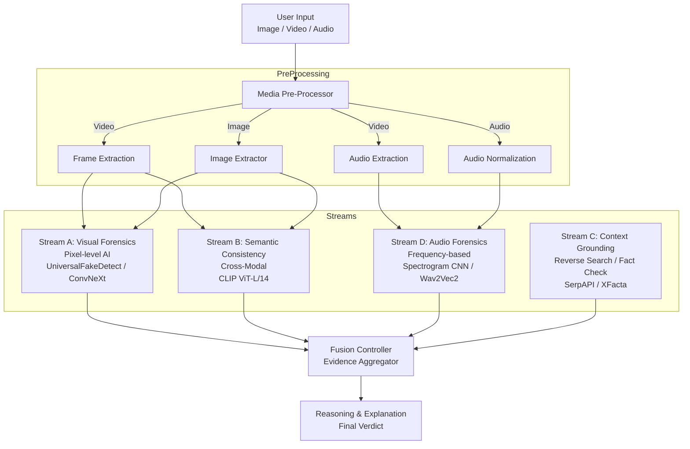

# Echelon / Veritas - System Architecture

## 1. High-Level Multi-Stream Architecture

## 2. Execution Pipeline

### Routing Logic

1. **IF Image**:
    * Stream A (Visual)
    * Stream B (Semantic)
    * Stream C (Context)
2. **IF Audio**:
    * Stream D (Audio)
    * Stream C (Context - Optional)
3. **IF Video**:
    * **Frame Extraction**: Middle frame / Keyframes -> Analyzed as Image (Streams A & B)
    * **Audio Extraction**: Track isolated -> Analyzed as Audio (Stream D)
    * **Results Fusion**: Combined confidence score.

## 3. Stream Specifications

### Stream D: Audio Forensics

* **Preprocessing**: Resample (16kHz), Normalize, Windowing.
* **Features**: Phase Coherence, Band Energy, Temporal Artifacts.
* **Model**: `Hemgg/Deepfake-audio-detection` (Wav2Vec2).

### Stream A: Visual Forensics

* **Model**: `CNN_Finetune` (ResNet50/ConvNeXt) + `UniversalFakeDetect`.
* **Technique**: Frequency Domain Analysis (DCT), Error Level Analysis (ELA).
