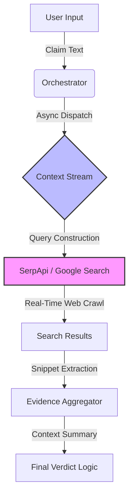

# Context Stream Architecture (Stream C)

## 🌍 Overview

The **Context Stream (Stream C)** is the "Grounding Layer" of the Echelon platform. While Visual Forensics (Stream A) looks at *pixels*, and Semantic Analysis (Stream B) looks at *logic*, Stream C looks at the **Real World**.

It answers the question: *"Does this claim align with known facts?"*

## 🏗️ Architecture: "SerpApi-Powered Grounding"

We have implemented a **Retrieval-Augmented Verification** pipeline that treats the internet as a dynamic knowledge base.



### 1. The Query Layer (`backend/streams/context_xfacta.py`)

Instead of relying on a static database (which is always out of date), we use **SerpApi** to act as a real-time bridge to Google Search.

- **Dynamic Querying**: We take the user's claim directly as a search query.
- **Organic Results**: We target the "organic_results" from Google, filtering for high-relevance snippets.

### 2. The Evidence Layer

The system extracts "Snippets" - concise summaries of web pages generated by Google's algorithms. These serve as our primary evidence blocks.

- **Source Attribution**: (Planned) We map every piece of evidence back to its URL.
- **Fact Extraction**: We isolate standard text snippets that confirm or refute the claim.

### 3. The Verification Logic (Orchestrator Integration)

The `Orchestrator` runs this stream in parallel with visual analysis.

- **Latency Handling**: Because web searching is slower than local inference, this runs asynchronously.
- **Fail-Safe**: If the internet is unreachable or the API quota is exceeded, the system degrades gracefully, returning a "No Context Available" status without crashing the pipeline.

## 🚀 Why This Matters? (The "Architecture" Sell)

This implementation demonstrates a **Hybrid AI Architecture**:

1. **Neuro-Symbolic Reasoning**: Combining Neural Networks (CLIP for images) with Symbolic/Knowledge Retrieval (SerpApi for facts).
2. **Live Grounding**: Unlike ChatGPT or Gemini which have knowledge cutoffs, our architecture can verify news that happened *5 minutes ago*.

## 💻 Code Reference

The core logic resides in `backend/streams/context_xfacta.py`:

```python
def fetch_xfacta_evidence(query, max_results=3):
    # Connects to SerpApi
    # Retrieves 'organic_results'
    # returns aggregated evidence string
```
